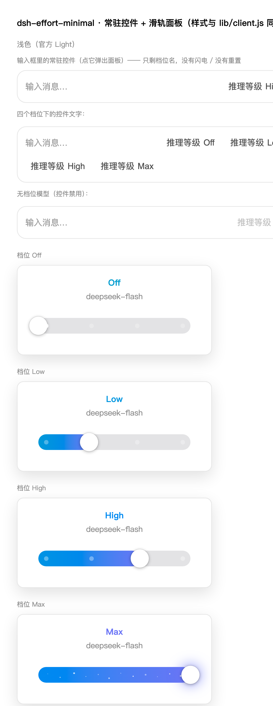

# dsh-effort-minimal

为 [DeepSeek Harness (DSH)](https://github.com/deepseek-ai/deepseek-harness) 的输入框添加常驻推理档位控件。点击档位名可打开滑轨，选择当前模型支持的推理等级，也可在同一个面板切换模型。

An always-visible reasoning-effort control for the DeepSeek Harness composer. It reads the model catalog and writes selections through DSH's client APIs.



## 功能

- 档位取自当前模型的目录元数据；不会写死 `Off / Low / High / Max`。
- 支持点击、拖动、方向键、Home / End 选择档位；Esc 或点击外部关闭面板。
- 面板内可切换模型。切换模型时交由 DSH 选择该模型的默认推理档位。
- 浅色与深色主题跟随 DSH 主题变量；最高档带粒子和一次性动效，并尊重系统的「减少动态效果」设置。
- 不需要 API Key，也不包含宿主端网络请求。

## 兼容性

`package.json` 声明 DSH `>=0.1.5-rc.2 <0.3.0`。本项目在 DSH Desktop `0.2.0-rc.2` 与 `@deepseek-ai/dsh*` `0.1.5-rc.2` 环境验证；上游仍处于开发预览期，后续接口变化可能需要适配。

本插件占用输入框的 `conversation.input.right` 座位。若同时启用其他推理档位控件（例如 `dsh-effort-slider`），界面可能出现重复控件，请只启用一个。

## 安装

### 从 GitHub 安装

代码推送到此仓库后，在 DSH Web 的「插件」页面添加 `github:SHISHISHI465/dsh-effort-minimal`，或在命令行运行：

```sh
dsh plugin --profile web add github:SHISHISHI465/dsh-effort-minimal
```

安装后重启 `dsh web`，并刷新浏览器页面。

### 从本地目录安装

在源码目录保持固定位置的前提下，可以使用链接安装；移动目录后需要重新安装：

```sh
dsh plugin --profile web add link:/absolute/path/to/dsh-effort-minimal
```

### DSH Desktop

在应用内的「插件」页面添加上述 GitHub 来源或本地目录。也可先启动一次 Desktop 初始化 `desktop` profile，完全退出应用后使用其 `dsh` 命令安装，再重新打开应用：

```sh
dsh plugin --profile desktop add github:SHISHISHI465/dsh-effort-minimal
```

桌面端操作依 DSH 版本而异；参见 [官方 Desktop 文档](https://github.com/deepseek-ai/deepseek-harness/blob/master/apps/desktop/README.zh.md)。

### npm

首次 npm 发布完成后，才可使用 `dsh plugin --profile web add dsh-effort-minimal`。发布前请使用 GitHub 或本地目录安装；发布步骤见 [发布说明](docs/RELEASING.md)。

## 使用

1. 打开一个已选模型的会话；档位名会出现在输入框中。
2. 点击档位名打开面板。点击轨道、拖动圆点，或用方向键调整档位。
3. 点击面板中的模型名可切换模型。当前模型没有可选推理档位时，控件会禁用。

## 开发

仓库无需构建插件本体。`lib/index.js` 是宿主入口，`lib/client.js` 是浏览器端 bundle，`cordis.patch.yml` 将插件加入 DSH 配置。

```sh
node scripts/preflight.mjs
cd test && npm ci && npm test
```

要预览面板，可运行 `node scripts/build-preview.mjs` 并打开 `preview/panel-preview.html`。浏览器动画验证另需 Chrome：`node scripts/verify-animation.mjs`。实现与排错记录见 [开发文档](docs/DEVELOPMENT.md)。

## 许可

[MIT](LICENSE)。本仓库不包含 DSH 官方源码。此插件是社区项目，并非 DeepSeek 官方产品。
